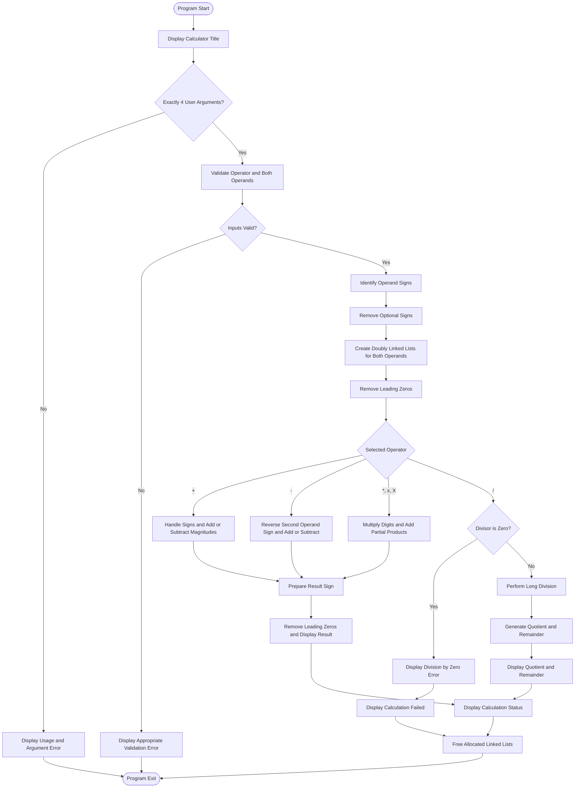

# 🧮 Arbitrary Precision Calculator — Large Number Arithmetic

## 📖 Overview

The **Arbitrary Precision Calculator (APC)** project is a command-line based C application that performs arithmetic operations on large integers beyond the limits of standard integer data types.

The application supports four main arithmetic operations:

1. **Addition** of two large integers using `+`.
2. **Subtraction** of two large integers using `-`.
3. **Multiplication** of two large integers using `*`, `x`, or `X`.
4. **Division** of two large integers using `/`, producing both quotient and remainder.

The project represents each digit of an operand as a node in a **doubly linked list**. This allows the calculator to process numbers digit by digit using dynamically allocated memory. It also handles positive and negative operands, validates command-line inputs, removes unnecessary leading zeros, and checks for division by zero.

## 🎯 Why This Project?

This project provides practical experience in implementing arithmetic operations without relying on built-in integer arithmetic for the complete number. It demonstrates how large numbers can be represented and processed using linked lists.

Key concepts practiced include:

- Command-line argument handling using `argc` and `argv`
- Modular programming in C
- Doubly linked lists and dynamic memory allocation
- Digit-by-digit addition with carry
- Digit-by-digit subtraction with borrow
- Multiplication using partial products
- Division using the long division method
- Operand comparison and sign handling
- Leading-zero removal
- Memory allocation and deallocation
- Input validation and error handling
- Terminal formatting using ANSI escape codes

## 🛠️ Technologies Used

| Technology / Concept | Usage |
| -------------------- | ----- |
| **C** | Core programming language |
| **Command-Line Arguments** | Accepts two operands and an arithmetic operator |
| **Doubly Linked Lists** | Stores each digit of large operands and calculation results |
| **Dynamic Memory Allocation** | Creates linked-list nodes using `malloc()` |
| **Pointers** | Manages linked-list nodes and arithmetic results |
| **Arithmetic Logic** | Performs addition, subtraction, multiplication, and division |
| **Structures** | Defines each linked-list node with data, previous, and next pointers |
| **String Handling** | Validates and converts operand strings into digit lists |
| **Memory Management** | Releases allocated nodes using `free()` |
| **ANSI Escape Codes** | Displays colored terminal messages |
| **Modular Programming** | Separates arithmetic operations, common linked-list functions, and main control flow |

The project uses standard C headers including `stdio.h`, `string.h`, and `stdlib.h`.

## 🏗️ System Architecture

```text
                                 +---------------------------+
                                 |           main.c          |
                                 | Command-Line Arguments    |
                                 | Input Validation          |
                                 | Sign Handling             |
                                 | Operation Selection       |
                                 +-------------+-------------+
                                               |
                                 +-------------+---------------+
                                 |                             |
                                 v                             v
                          +--------------+             +----------------+
                          |     apc.c    |             |     apc.h      |
                          | Common Logic |             | Node Structure |
                          | Validation   |             | Prototypes     |
                          | Linked Lists |             | Status Codes   |
                          +------+-------+             +----------------+
                                 |
          +-------------+--------------+---------------+
          |             |              |               |
          v             v              v               v
    +-----------+ +-------------+ +----------------+ +------------+
    |   add.c   | |   sub.c     | |   mul.c        | |   div.c    |
    | Addition  | | Subtraction | | Multiplication | | Division   |
    | Carry     | | Borrow      | | Partial        | | Quotient   |
    |  Handling | |  Handling   | |  Products      | |  Remainder |
    +-----+-----+ +------+------+ +-------+--------+ +-----+------+
          |              |                |                |
          +--------------+-------+--------+----------------+
                                 |       
                                 v       
                       +--------------------+
                       | Result Linked List |
                       | Quotient /         |
                       | Remainder Lists    |
                       +---------+----------+
                                 |
                                 v
                       +--------------------+
                       | Display Final      |
                       | Calculation Result |
                       +--------------------+

                       Doubly Linked List Node
                       +--------------------+
                       | prev | data | next |
                       +--------------------+
```

## 🔄 Program Flow



## 📂 Project Structure

```text
Arbitrary-Precision-Calculator_Naveenkumar-Kammar/
│
├── README.md
├── main.c
├── apc.c
├── apc.h
├── add.c
├── sub.c
├── mul.c
├── div.c
│
└── Sample_Outputs/
    ├── Addition_Operation.png
    ├── Subtraction_Operation.png
    ├── Multiplication_Operation.png
    ├── Division_Operation.png
    ├── Invalid_Input_Validation.png
    └── Division_By_Zero_Error.png
```

## 🔑 Key Functions

### ➕ Addition

Addition uses the following command format:

```bash
./a.out <operand1> + <operand2>
```

The addition process:

1. Starts from the tail nodes of both operand lists, processing digits from right to left.
2. Adds the corresponding digits and the carry from the previous position.
3. Calculates the next carry using integer division by 10.
4. Extracts the current result digit using modulo 10.
5. Inserts each result digit at the beginning of the result list.
6. Continues until both operands and any remaining carry are processed.

### ➖ Subtraction

Subtraction uses the following command format:

```bash
./a.out <operand1> - <operand2>
```

The subtraction process:

1. Determines the effective signs of the operands.
2. Compares the absolute values when subtraction of magnitudes is required.
3. Starts from the tail nodes and subtracts digits from right to left.
4. Applies a borrow when the current digit difference is negative.
5. Inserts each calculated digit at the beginning of the result list.
6. Assigns the correct result sign based on operand signs and magnitude comparison.

### ✖️ Multiplication

Multiplication uses any of the following command formats:

```bash
./a.out <operand1> '*' <operand2>
./a.out <operand1> x <operand2>
./a.out <operand1> X <operand2>
```

The multiplication process:

1. Processes each digit of the second operand from right to left.
2. Multiplies that digit with every digit of the first operand.
3. Calculates each product digit and carry.
4. Builds a partial-product linked list.
5. Appends positional zeros to the partial product according to its digit position.
6. Adds each partial product to the accumulated result using the addition function.
7. Applies the final result sign based on the signs of both operands.

When using `*` in a shell command, quote it as shown so the shell passes it as an operator argument.

### ➗ Division

Division uses the following command format:

```bash
./a.out <operand1> / <operand2>
```

The division process:

1. Checks whether the divisor is zero.
2. Traverses the dividend from left to right.
3. Appends the next dividend digit to the current remainder.
4. Removes leading zeros from the remainder.
5. Compares the remainder with the divisor.
6. Repeatedly subtracts the divisor while the remainder is greater than or equal to it.
7. Counts the number of subtractions to obtain the next quotient digit.
8. Stores the quotient digits and continues until all dividend digits are processed.
9. Displays the quotient and remainder. The quotient sign follows the product of operand signs, while the remainder sign follows the first operand.

Division by zero is rejected with an error message.

### 🧩 Doubly Linked List Representation

Each digit of an operand is stored in an individual node. The node structure contains:

- `prev` — points to the previous digit node.
- `data` — stores one decimal digit.
- `next` — points to the next digit node.

The input number is built by inserting digits at the end of the list. Addition and subtraction process digits from the tail, while division traverses the dividend from the head. Result digits are inserted at the beginning or end as required by the operation.

### 🛡️ Validation and Error Handling

The application validates:

1. The command-line argument count.
2. That the operator is exactly one supported character: `+`, `-`, `*`, `x`, `X`, or `/`.
3. That both operands contain valid decimal digits, with an optional leading `+` or `-` sign.
4. Memory allocation while creating and updating linked lists.
5. Division by zero before starting the division process.

The program reports invalid argument count, invalid operator, invalid first or second operand, memory allocation failure, and division-by-zero errors. It also removes unnecessary leading zeros and ensures that a zero result is displayed without a negative sign.

## 💾 Linked List and Memory Handling

### 📥 Operand Creation

```text
Command-Line Operand
        |
        v
Read Each Character
        |
        v
Convert Character to Integer Digit
        |
        v
Allocate a New Node
        |
        v
Insert Node at the End
        |
        v
Doubly Linked List
```

### 📤 Result Creation and Cleanup

```text
Arithmetic Operation
        |
        v
Calculate Result Digit
        |
        v
Insert Digit into Result List
        |
        v
Remove Leading Zeros
        |
        v
Display Final Result
        |
        v
Delete Allocated Linked-List Nodes
```

The program uses dynamic memory allocation for linked-list nodes. The common linked-list functions create, insert, display, compare, and delete nodes. The main function releases the operand, result, and remainder lists before returning from the normal calculation flow.

## 🚀 How to Run

### 🔧 Compile

Compile all source files together from the project directory:

```bash
gcc main.c apc.c add.c sub.c mul.c div.c
```

The command generates the default executable named `a.out`.

### ▶️ Run

**Addition**

```bash
./a.out 12345678901234567890 + 98765432109876543210
```

**Subtraction**

```bash
./a.out 98765432109876543210 - 12345678901234567890
```

**Multiplication**

```bash
./a.out 12345678901234567890 '*' 987
```

**Division**

```bash
./a.out 1234 / 12
```

**Negative Operands**

```bash
./a.out -500 + 250
./a.out -500 - 250
./a.out -25 '*' 4
./a.out -100 / 7
```

**❌ Invalid Usage Examples**

```bash
./a.out
./a.out 100 +
./a.out abc + 100
./a.out 100 @ 20
./a.out 100 / 0
```

Provide exactly two integer operands and one supported operator. Each operand may contain an optional leading sign. The division operation displays both quotient and remainder.

## 📚 Learnings & Outcomes

- Improved understanding of command-line arguments using `argc` and `argv`.
- Practiced modular C programming by separating arithmetic operations into individual source files.
- Implemented large-integer representation using a doubly linked list.
- Strengthened pointer handling through head, tail, previous, and next node links.
- Practiced dynamic memory allocation using `malloc()` and memory deallocation using `free()`.
- Implemented addition with carry and subtraction with borrow.
- Learned multiplication using digit-wise partial products and positional zeros.
- Implemented division using the long division method to calculate quotient and remainder.
- Practiced operand comparison, positive and negative number handling, and leading-zero removal.
- Improved input validation, error handling, and memory management.
- Gained practical experience in building a modular command-line calculator in C.

## ⭐ Project Summary

> **Arbitrary Precision Calculator (APC)** is a command-line C application that performs addition, subtraction, multiplication, and division on large integers using doubly linked lists. It demonstrates digit-wise arithmetic, carry and borrow handling, partial-product multiplication, long division, sign management, dynamic memory allocation, command-line validation, and modular programming.

## 👨‍💻 Author

**Naveenkumar Kammar**
